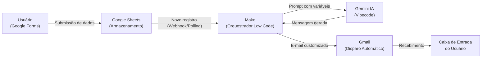
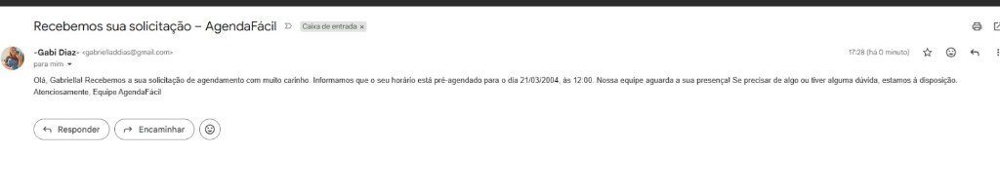

# AgendaFácil: Sistema de Agendamento com Confirmação Automática por IA

> **Projeto Acadêmico — Paradigmas No Code, Low Code e Vibecode**  
> **Instituição:** Centro Universitário do Distrito Federal (UDF)  
> **Disciplina:** Tendências em Ciência da Computação  
> **Docente:** Profa. Kadidja Valéria  

---

## Sumário
- [1. Visão Geral e Descrição do Desafio](#1-visão-geral-e-descrição-do-desafio)
- [2. Justificativa das Tecnologias e Paradigmas](#2-justificativa-das-tecnologias-e-paradigmas)
- [3. Arquitetura da Solução e Fluxo de Dados](#3-arquitetura-da-solução-e-fluxo-de-dados)
- [4. Evidências do Protótipo Funcional](#4-evidências-do-protótipo-funcional)
- [5. Reflexão Crítica: Vantagens e Limitações](#5-reflexão-crítica-vantagens-e-limitações)
- [6. Colaboração em Equipe e Divisão de Papéis](#6-colaboração-em-equipe-e-divisão-de-papéis)
- [7. Apresentação e Recursos Adicionais](#7-apresentação-e-recursos-adicionais)

---

## 1. Visão Geral e Descrição do Desafio

### O Desafio
Em micro e pequenas operações (consultórios, tutorias acadêmicas, escritórios de assessoria), o agendamento de atendimentos é historicamente manual, sujeito a esquecimentos, falhas de comunicação e retrabalho na confirmação de datas e horários. O desenvolvimento de um sistema completo com backend tradicional (Node.js/Python, banco de dados relacional e infraestrutura de servidores) demanda alto custo financeiro e tempo inviável para validação inicial de produto (MVP).

### A Solução: AgendaFácil
O **AgendaFácil** é um protótipo funcional desenhado para eliminar atritos operacionais de agendamento. Ele integra ferramentas visuais e inteligência artificial para registrar solicitações de agendamento e gerar, de forma instantânea, confirmações por e-mail contextualizadas e personalizadas para o solicitante — sem necessidade de infraestrutura de servidor dedicada.

---

## 2. Justificativa das Tecnologias e Paradigmas

A solução foi concebida para demonstrar na prática os três conceitos essenciais da disciplina:

| Paradigma | Ferramenta Escolhida | Função no Projeto | Justificativa Técnica |
| :--- | :--- | :--- | :--- |
| **No Code** | **Google Forms** e **Google Sheets** | Coleta de dados e persistência (banco de dados) | Elimina a necessidade de codificação de frontend e backend. Formulário responsivo e planilha compartilhável com integração nativa no ecossistema Google. |
| **Low Code** | **Make (Integromat)** | Orquestração do fluxo e integração de serviços | Permite construir a lógica de gatilhos (triggers), tratamento de payloads JSON e encadeamento de chamadas com conectores visuais e baixo esforço de código. |
| **Vibecode / IA** | **Gemini (LLM)** via API | Geração de texto contextualizado para o e-mail | Aplicação de engenharia de prompts iterativa (Vibecoding) para transformar registros brutos de data e horário em uma mensagem empática, formal e personalizada. |
| **Canal de Entrega** | **Gmail (Google Workspace)** | Despacho das mensagens de confirmação | Entrega confiável na caixa de entrada do usuário final com alta entregabilidade. |

---

## 3. Arquitetura da Solução e Fluxo de Dados

O ciclo de vida de uma solicitação no **AgendaFácil** segue uma arquitetura orientada a eventos (event-driven):

### Passo a Passo da Operação:
1. **Entrada do Solicitante:** O usuário acessa o Google Forms e preenche Nome, E-mail, Data, Horário e Motivo do Atendimento.
2. **Persistência:** A resposta é gravada em uma nova linha no Google Sheets.
3. **Acionamento do Make:** O Make identifica a nova linha inserida na planilha e inicia o cenário de automação.
4. **Vibecoding e Enriquecimento por IA:** O Make monta um prompt com os dados do usuário e envia para a IA (Gemini), que redige um e-mail empático e instrutivo.
5. **Comunicação Final:** O conector do Gmail dispara a mensagem final diretamente para o e-mail cadastrado pelo solicitante.

---

## 4. Evidências do Protótipo Funcional

* **Formulário de Agendamento (Interface No Code):**  
  [Acessar Google Forms do Projeto](https://docs.google.com/forms/d/e/1FAIpQLSeUrNakukU2iuzlajc-QqJs3A2VwQwbnmd4A7x9Wko2DKn7bA/viewform?fbzx=9132521839375404503)

* **Planilha de Gestão e Persistência (Base de Dados):**  
  [Visualizar Google Sheets do Projeto](https://docs.google.com/spreadsheets/d/1KIiVpag0yPtn5sFVmCQoLY_oYuMNV52YlGkezrplq_0/edit?gid=961846671#gid=961846671)

* **Exemplo Real de E-mail de Confirmação Gerado por IA:**  
  

* **Cenário de Automação no Make:**  
  *(Aguardando inclusão da captura de tela do cenário)*

---

## 5. Reflexão Crítica: Vantagens e Limitações

### Vantagens da Abordagem Adotada
1. **Velocidade Extrema de Prototipação (Time-to-Market):**  
   A combinação de plataformas No Code e Low Code permitiu conceber, construir, integrar e validar o fluxo completo em menos de dois dias úteis, dispensando setup de ambiente local, bibliotecas de backend e infraestrutura de servidores.
2. **Custo Operacional e de Infraestrutura Zero:**  
   Todo o ecossistema opera sob as camadas gratuitas (free tiers) de serviços consolidados (Google Workspace, Make e APIs de IA), viabilizando testes rápidos de viabilidade técnica e de produto sem desembolso financeiro inicial.
3. **Humanização e Flexibilidade via Vibecode:**  
   Em vez de templates rígidos de e-mail com variáveis estáticas, a IA generativa adapta o tom da mensagem, inclui instruções adicionais e personaliza a saudação de acordo com o contexto informado.

### Limitações Enfrentadas
1. **Ausência de Validação de Conflitos em Tempo Real:**  
   Como o Google Forms nativo não consulta dinamicamente a planilha ou a agenda antes do envio, dois usuários podem submeter o mesmo horário. O protótipo atua como um sistema de solicitação de horário, e não reserva concorrencial em tempo real.
2. **Dependência de Quotas e Latência em Planos Gratuitos:**  
   O plano gratuito do Make impõe limites de operações mensais (1.000 operações) e frequência de polling (checagem periódica se não houver webhook instantâneo). Picos de agendamento podem pausar a esteira de automação.
3. **Governança de Dados e Dependência de Terceiros (Vendor Lock-in):**  
   Os dados dos usuários trafegam por múltiplos provedores externos de nuvem. Qualquer alteração de contrato de API, instabilidade temporária no Make ou mudanças na política de IA impactam a disponibilidade do fluxo.

---

## 6. Colaboração em Equipe e Divisão de Papéis

Em conformidade com as diretrizes da disciplina, a equipe distribuiu as responsabilidades de forma complementar e colaborativa:

| Integrante | Papel Principal | Atividades Executadas |
| :--- | :--- | :--- |
| **Maria Cecília** | *Interface e Dados (UX/UI)* | Criação e parametrização do formulário no Google Forms e formatação estruturada da base de dados no Google Sheets. |
| **Gabriella Dias** | *Automação e Lógica (Low Code)* | Construção do cenário de integração no Make, configuração dos gatilhos, mapeamento de payloads e filtros. |
| **João Pedro Alves** | *Vibecode e Inteligência Artificial* | Engenharia de prompts para o Gemini, refinamento iterativo das saídas de IA e integração da resposta com o Make. |
| **Gustavo Negreiros** | *Documentação, Testes e Apresentação* | Validação e testes ponta a ponta do fluxo, documentação técnica no GitHub e desenvolvimento dos slides acadêmicos em LaTeX Beamer. |

---

## 7. Apresentação e Recursos Adicionais

* **Slides em LaTeX (Beamer):** Localizados no diretório [`slides/main.tex`](slides/main.tex), prontos para compilação no Overleaf.
* **Roteiro da Apresentação:** Cobertura didática do problema, demonstração do tripé No Code, Low Code e Vibecode, análise crítica e próximos passos para evolução do produto (como integração com Google Calendar API e WhatsApp).
